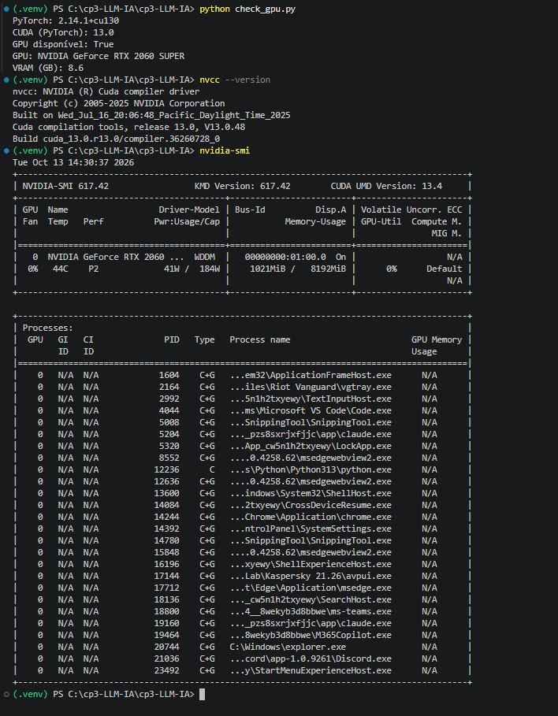
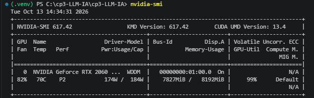
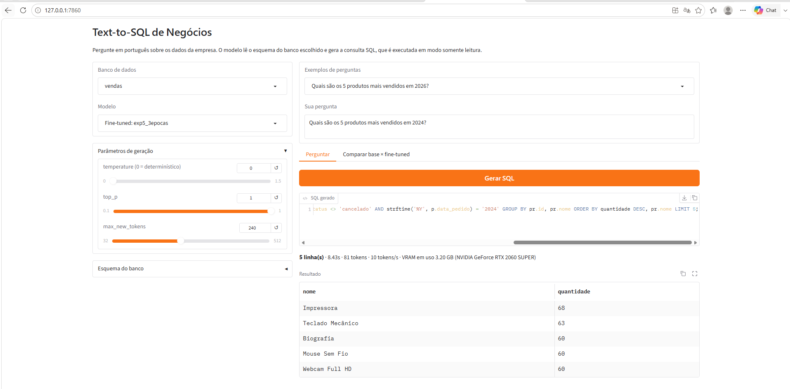

# CP3 — Text-to-SQL de Negócios com LLM local

Fine-tuning de uma LLM local, na GPU, para transformar **perguntas de negócio em português** em **consultas SQL** sobre bancos de dados da empresa. O usuário escolhe o banco (vendas, RH ou financeiro), faz a pergunta e recebe o SQL gerado já executado, com o resultado em tabela.

**Turma:** 4ESPW 

| Integrante | RM |
|---|---|
| Pedro Guerra | RM99526 |
| João Saborido | RM98184 |
| Matheus Haruo | RM97663 |
| Victor Wittner| RM98667|

---

## 1. Problema

Gestores fazem perguntas como *"Qual foi o faturamento de 2025?"* ou *"Quanto ainda falta pagar aos fornecedores?"*, mas os dados estão em bancos relacionais e exigem SQL. O desafio não é só sintaxe: cada empresa tem **regras de negócio** (o que conta como faturamento, o que é um funcionário ativo, o que está em aberto) que um modelo genérico não conhece.

**Solução:** o banco de dados é um **parâmetro** da pergunta. O esquema do banco escolhido (DDL + regras de negócio em comentários) vai junto no prompt, e o modelo é treinado para ler esse esquema e aplicar as regras. Assim ele aprende a *interpretar* o banco em vez de decorar respostas.

## 2. Modelo escolhido

| Item | Escolha | Motivo |
|---|---|---|
| LLM | `Qwen/Qwen2.5-Coder-1.5B-Instruct` | Modelo pequeno especializado em código/SQL, cabe na GPU de 8 GB |
| Técnica | LoRA (e QLoRA 4-bit em um experimento) | Treina ~1% dos parâmetros; viável numa GPU doméstica |
| Precisão | fp16 | A RTX 2060 (arquitetura Turing) não suporta bf16 |
| Atenção | SDPA | FlashAttention 2 exige arquitetura Ampere ou superior |

## 3. Ambiente (GPU)

| Componente | Versão |
|---|---|
| GPU | NVIDIA GeForce RTX 2060 SUPER (8 GB, compute capability 7.5) |
| CPU / RAM | Intel Core i7 9ª geração / 16 GB |
| Driver NVIDIA | 617.42 (suporta CUDA até 13.4) |
| CUDA Toolkit | 13.0 |
| PyTorch | 2.14.1+cu130 |
| Python | 3.13 |
| SO / IDE | Windows + VS Code (extensões GPU Monitor e GPU Environments) |

### Prints da GPU no VS Code




### Instalação

```powershell
py -3.13 -m venv .venv
.venv\Scripts\activate
pip3 install torch torchvision --index-url https://download.pytorch.org/whl/cu130
pip install -r requirements.txt
python check_gpu.py
```

## 4. Dados

### Bancos de negócio (SQLite)

Três bancos com dados sintéticos realistas (jan/2024 a set/2026), gerados com semente fixa por `data/build_databases.py`:

| Banco | Tabelas | Exemplos de regra de negócio no esquema |
|---|---|---|
| `vendas` | categorias, produtos, clientes, pedidos, itens_pedido | faturamento exclui pedidos cancelados e aplica desconto; ticket médio; margem bruta |
| `rh` | departamentos, cargos, funcionarios, avaliacoes | ativo = sem data de desligamento; headcount; folha salarial |
| `financeiro` | centros_custo, fornecedores, contas_bancarias, lancamentos | saldo = receitas − despesas; "em aberto" = pendente ou atrasado |

Os esquemas comentados ficam em [`data/schemas/`](data/schemas).

### Dataset pergunta → SQL

Gerado por `data/generate_dataset.py` a partir de **52 templates** de perguntas de negócio, cada um com **4 formulações diferentes** em português e valores variáveis (anos, meses, estados, departamentos, top N…).

| Split | Exemplos | Conteúdo |
|---|---|---|
| train | 576 | formulações 1 a 3 de cada template |
| val | 63 | amostra do treino, para acompanhar a loss |
| test | 120 | **somente a 4ª formulação**, nunca vista no treino |

Todo SQL do dataset é executado nos bancos durante a geração; o script falha se alguma consulta der erro ou vier vazia.

## 5. Pipeline

```powershell
python data/build_databases.py                          # cria data/db/*.sqlite
python data/generate_dataset.py                         # cria data/dataset/*.jsonl
python src/evaluate.py --name base                      # linha de base (sem treino)
python src/train.py --config configs/exp1_baseline.yaml # fine-tuning na GPU
python src/evaluate.py --name exp1_baseline --adapter outputs/exp1_baseline/adapter
python src/compare_results.py                           # tabela em results/resumo.md
python app/app.py                                       # frontend em http://127.0.0.1:7860
```

Ou tudo de uma vez: `.\scripts\run_experiments.ps1`.

## 6. Testes de parâmetros

### Parâmetros de treino

| Experimento | O que varia |
|---|---|
| `exp1_baseline` | LoRA r=16, lr 2e-4, 2 épocas, fp16 |
| `exp2_lr_baixo` | learning rate 5e-5 |
| `exp3_rank8` | rank do LoRA 8 (metade dos parâmetros treináveis) |
| `exp4_qlora` | modelo base quantizado em 4 bits (QLoRA) |
| `exp5_3epocas` | 3 épocas |

### Parâmetros de geração

Avaliados sobre o melhor modelo treinado: `temperature` 0 (greedy), 0.3, 0.7 e 1.0, com `top_p` 0.9–0.95.

## 7. Avaliação

| Métrica | Definição |
|---|---|
| **Execution accuracy** (principal) | o SQL gerado retorna o mesmo resultado que o SQL de referência (ordem de linhas/colunas e nomes de colunas ignorados; números com 2 casas) |
| SQL válido | o SQL gerado executa sem erro |
| Exact match | texto idêntico ao de referência após normalização |
| Latência e tokens/s | desempenho de inferência na GPU |

As predições de cada experimento ficam em `results/preds_<experimento>.jsonl` para análise de erros.

## 8. Resultados

Todos os treinos e avaliações rodaram na RTX 2060 SUPER. Conjunto de teste: 120 perguntas com formulações nunca vistas no treino (50 de vendas, 35 de RH, 35 de financeiro).

### Treinos

| Experimento | LoRA r | Learning rate | Épocas | 4-bit | Loss treino | Loss val | Tempo (min) | Pico VRAM (GB) |
|---|---|---|---|---|---|---|---|---|
| exp1_baseline | 16 | 2e-4 | 2 | não | 0.0605 | 0.0069 | 10.0 | 7.84 |
| exp2_lr_baixo | 16 | 5e-5 | 2 | não | 0.1239 | 0.0315 | 10.0 | 7.84 |
| exp3_rank8 | 8 | 2e-4 | 2 | não | 0.0770 | 0.0099 | 10.3 | 7.70 |
| exp4_qlora | 16 | 2e-4 | 2 | sim | 0.0604 | 0.0069 | 11.6 | 7.11 |
| exp5_3epocas | 16 | 2e-4 | 3 | não | 0.0445 | 0.0024 | 17.4 | 7.84 |

### Avaliação no teste

| Modelo | Temperature | top_p | Execution acc. (%) | SQL válido (%) | Exact match (%) | vendas | rh | financeiro | Latência (s) | Tokens/s |
|---|---|---|---|---|---|---|---|---|---|---|
| **base (sem treino)** | 0.0 | 1.0 | **16.7** | 57.5 | 0.0 | 12.0 | 14.3 | 25.7 | 1.78 | 24.5 |
| exp1_baseline | 0.0 | 1.0 | **85.8** | 95.0 | 76.7 | 92.0 | 88.6 | 74.3 | 4.96 | 11.4 |
| exp2_lr_baixo | 0.0 | 1.0 | **65.8** | 98.3 | 40.0 | 60.0 | 80.0 | 60.0 | 5.17 | 10.9 |
| exp3_rank8 | 0.0 | 1.0 | **85.8** | 97.5 | 74.2 | 94.0 | 85.7 | 74.3 | 5.22 | 10.9 |
| exp4_qlora | 0.0 | 1.0 | **90.8** | 97.5 | 70.8 | 100.0 | 94.3 | 74.3 | 6.06 | 9.5 |
| exp5_3epocas | 0.0 | 1.0 | **90.0** | 97.5 | 82.5 | 94.0 | 91.4 | 82.9 | 4.83 | 11.5 |
| exp1 + temp 0.3 | 0.3 | 0.9 | **86.7** | 95.0 | 75.8 | 92.0 | 88.6 | 77.1 | 5.11 | 11.1 |
| exp1 + temp 0.7 | 0.7 | 0.9 | **83.3** | 95.0 | 75.0 | 88.0 | 85.7 | 74.3 | 4.90 | 11.6 |
| exp1 + temp 1.0 | 1.0 | 0.95 | **84.2** | 95.8 | 66.7 | 90.0 | 88.6 | 71.4 | 4.69 | 12.0 |

### Análise

**1. O fine-tuning é o que faz o modelo funcionar no problema.** O modelo base acerta só 16,7% e gera SQL que nem executa em 42,5% dos casos. Ele entende a pergunta, mas não conhece o banco: no faturamento, por exemplo, usa colunas de `itens_pedido` sem fazer o `JOIN` com `pedidos`, ou usa `YEAR()` (MySQL) em vez de `strftime` (SQLite). Depois do fine-tuning, a acurácia sobe para 85–91% e o SQL válido para 95–98%, com o modelo aplicando as regras de negócio do esquema (excluir cancelados, considerar só funcionários ativos, etc.).

**2. Learning rate foi o parâmetro de treino mais importante.** Com 5e-5 (`exp2`), o modelo não convergiu em 2 épocas: loss de validação 4,5× maior e acurácia de 65,8%, 20 pontos abaixo do baseline. O SQL continua quase sempre válido (98,3%), mas o modelo ainda erra as regras de negócio: calcula ticket médio com `AVG` por item em vez de faturamento ÷ pedidos, calcula "lucro bruto" sem subtrair o custo e agrupa por produto quando a pergunta é por categoria. Ou seja, ele aprendeu a sintaxe e o esquema antes das regras de negócio.

**3. Mais épocas ajudaram sem overfitting visível.** O `exp5` (3 épocas) teve a menor loss de validação, o maior exact match (82,5%) e o melhor resultado no banco financeiro (82,9%), sem perder desempenho nas formulações inéditas do teste. O custo foi 74% mais tempo de treino.

**4. Rank do LoRA: r=8 empatou com r=16.** Com metade dos parâmetros treináveis, o `exp3` teve a mesma acurácia do baseline (85,8%). Para uma tarefa desse tamanho, r=8 já é suficiente.

**5. QLoRA: mesma qualidade com menos VRAM, porém inferência mais lenta.** O `exp4` teve loss praticamente idêntica ao baseline e a maior acurácia (90,8%), usando 0,7 GB a menos de VRAM no treino. A economia é pequena porque o modelo tem só 1,5B parâmetros; a maior parte da memória vai para ativações e para os logits do vocabulário (~150 mil tokens). Em compensação, a inferência em 4 bits foi a mais lenta (9,5 tokens/s).

**6. Temperature: para SQL, quanto mais determinístico, melhor.** Entre 0 e 0,3 a acurácia ficou estável (85,8% → 86,7%), mas com 0,7 e 1,0 ela cai e o exact match despenca (76,7% → 66,7%). Como uma consulta SQL tem uma resposta correta, amostrar tokens menos prováveis só introduz variações e erros. O app usa temperature 0 por padrão.

**7. Financeiro foi o banco mais difícil** (74–83% contra 92–100% em vendas). Os erros que se repetem entre os modelos treinados são de interpretação de perguntas parecidas com outro template:
- *"Qual foi o maior gasto individual?"* → o modelo agrupou por fornecedor (template de "top fornecedores") em vez de pegar o maior lançamento.
- *"Quanto ainda falta pagar aos fornecedores?"* → considerou só `pendente`, esquecendo `atrasado`, apesar da regra "em aberto" estar no esquema.
- *"Quem são os 5 funcionários mais bem pagos?"* → somou salários com um `JOIN` em `avaliacoes`, duplicando linhas.
- *"Quantos lançamentos estão pagos, pendentes e atrasados?"* → devolveu um total único em vez de agrupar por status.

Alguns erros são de ambiguidade real: em *"Quanto temos em atraso?"*, o modelo filtrou só despesas, uma leitura razoável que difere da referência (receitas e despesas).

**8. Latência.** O modelo treinado gera ~11 tokens/s contra 24,5 do base, porque os adaptadores LoRA são aplicados por cima do modelo em cada passo. Mesclar o adaptador nos pesos (`merge_and_unload`) eliminaria esse custo.

**Ressalva estatística:** com 120 perguntas no teste, cada questão vale 0,83 ponto percentual. Diferenças de até ~3–4 pontos (como entre `exp4` e `exp5`, ou entre temperature 0 e 0,3) estão dentro da variação esperada e não devem ser lidas como superioridade clara. Além disso, a métrica é rígida em rankings com empate: um "top 10" que escolhe outro produto empatado na 10ª posição conta como erro, mesmo sendo uma resposta válida.

**Modelo escolhido para o app:** `exp5_3epocas`. Ele empata em acurácia com o `exp4_qlora` (90,0% × 90,8%, diferença de uma pergunta), mas tem o maior exact match, o melhor desempenho no banco mais difícil e inferência 20% mais rápida.

## 9. Frontend

App em Gradio (`app/app.py`):

- escolha do **banco de dados** (o esquema aparece na tela e entra no prompt);
- escolha do **modelo** (base ou qualquer adaptador treinado);
- ajuste de **temperature, top_p e max_new_tokens**;
- execução do SQL em **modo somente leitura** (só `SELECT`, com timeout) e resultado em tabela;
- aba **Comparar base × fine-tuned** com a mesma pergunta lado a lado.



## 10. Estrutura

```
├── app/app.py                 # frontend Gradio
├── check_gpu.py               # verificação da GPU/CUDA
├── configs/                   # experimentos de fine-tuning (YAML)
├── data/
│   ├── schemas/               # DDL + regras de negócio de cada banco
│   ├── db/                    # bancos SQLite gerados
│   ├── dataset/               # train/val/test (jsonl)
│   ├── build_databases.py
│   └── generate_dataset.py
├── docs/prints/               # prints da GPU e do app
├── results/                   # métricas de treino/avaliação e resumo.md
├── scripts/run_experiments.ps1
└── src/
    ├── prompt.py              # formato do prompt (treino = inferência)
    ├── model_utils.py         # carga do modelo fp16/4-bit + geração
    ├── sql_utils.py           # execução segura e comparação de resultados
    ├── train.py               # fine-tuning LoRA/QLoRA
    ├── evaluate.py            # avaliação no teste
    └── compare_results.py     # tabela comparativa
```
